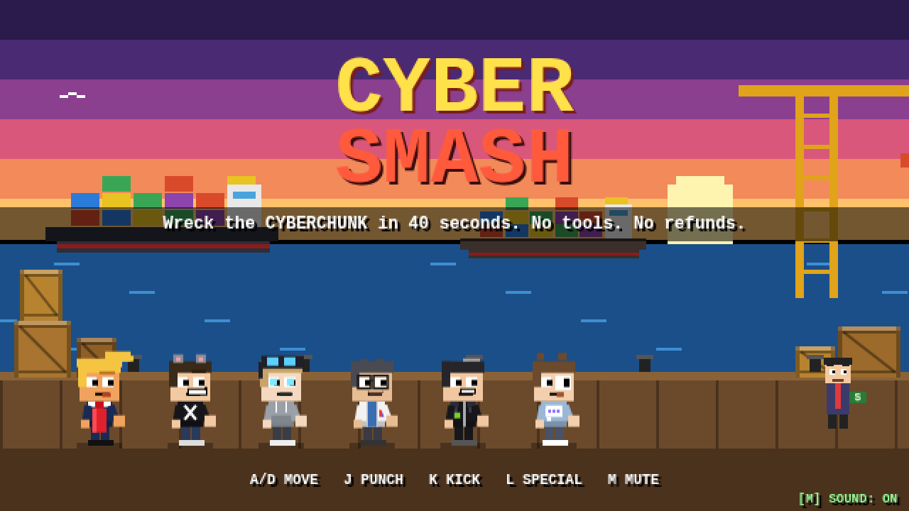
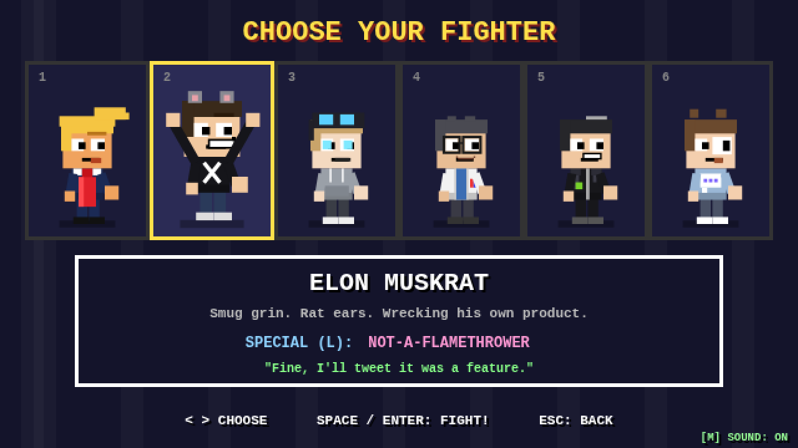
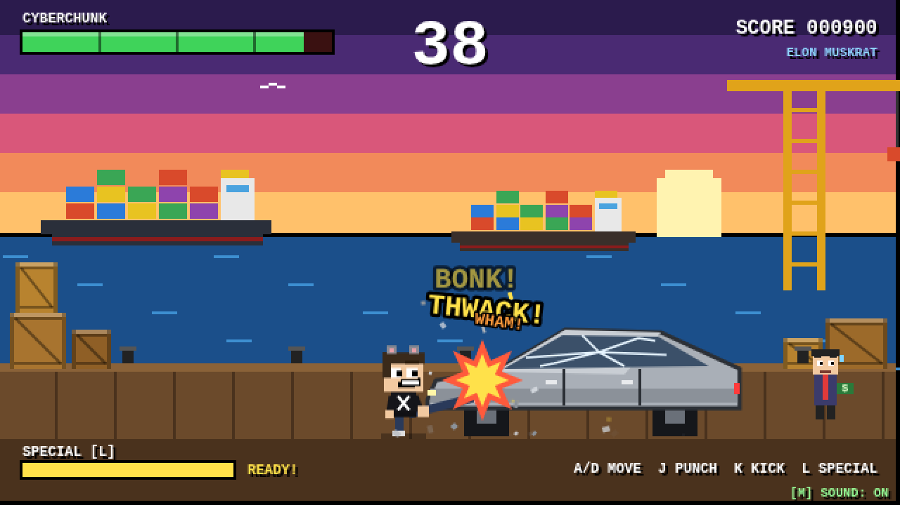
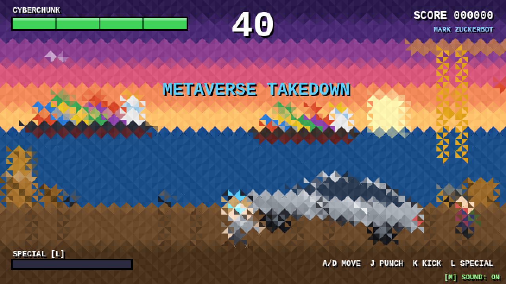
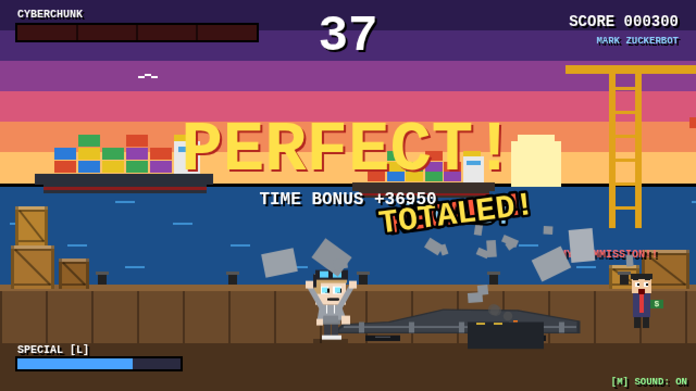
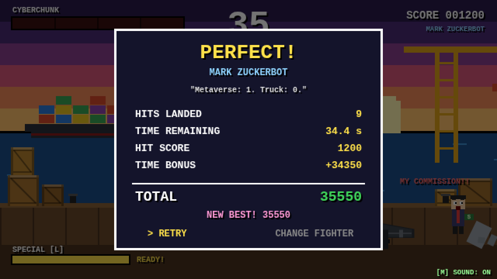

# 💥 CYBER SMASH

A comedic parody of the classic 90s arcade-fighter "destroy the car" bonus stage.
A shady salesman at a port can't sell his ugly, angular steel electric pickup — the **CYBERCHUNK** — so he pays
anyone who can wreck it with their bare hands in **under 40 seconds**.

**▶ Play it: https://fsystemweb.github.io/cybersmash/**

**🆕 Play the sequel — [CYBER SMASH II](https://fsystemweb.github.io/cybersmash-II/)** ([source](https://github.com/fsystemweb/cybersmash-II))

Everything lives in a single [`index.html`](index.html): vanilla JS + `<canvas>`, **no images, sprites, fonts or libraries**.
Every pixel is drawn with canvas shapes and every sound is synthesized with the Web Audio API.
You can also just download the file and open it in a browser.

| Title | Character select |
|---|---|
|  |  |

| Smashing | Metaverse Takedown (low-poly special) |
|---|---|
|  |  |

| PERFECT! | Results |
|---|---|
|  |  |

## Controls

| Key | Action |
|---|---|
| `←` `→` / `A` `D` | Move (walk up to the truck!) |
| `J` | Punch — fast, 1× damage, short reach |
| `K` | Kick — slower, longer reach, 1.5× damage |
| `L` | Special move — 3× damage, unique per fighter, 3 s cooldown (meter bottom-left) |
| `Space` / `Enter` | Start, confirm, retry |
| `Esc` | Back |
| `M` | Mute / unmute |

Hits only count when you're **in range** of the truck; a kick reaches farther than a punch. Melee specials (Zuckerbot, Hwatt)
need you close; the others work from a distance.

## The fighters (all original parodies)

| Fighter | Special |
|---|---|
| **Donald Tromp** — huge red tie, golden swoop | **YOU'RE FIRED!** — a giant rubber stamp slams the truck |
| **Elon Muskrat** — black tee, smug grin, rat ears | **Not-A-Flamethrower** — a flame burst (at his own product!) |
| **Mark Zuckerbot** — grey hoodie, robotic blink, VR headset | **Metaverse Takedown** — jiu-jitsu slam; the screen goes low-poly |
| **Demis Hassabyte** — calm scientist | **AlphaStrike** — calculates with a % overlay, then a perfect hit |
| **Jensen Hwatt** — iconic black leather jacket | **GPU Overclock** — glowing green fists, rapid-fire flurry |
| **Sam Oldman** — earnest chat-bubble hoodie | **AGI Beam** — a chat-bubble laser that types out "BOOM" |

## Rules & scoring

- 40 second countdown (flashing red with beeps in the last 5 s).
- The truck has 4 damage stages: **cracked windows → dents → panels fall off → collapse + smoking battery**.
- Each hit scores 100 × damage dealt. Destroy it in time for **PERFECT!** and a time bonus of *remaining seconds × 1000*.
  Run out of clock and the sale is **CANCELLED** (with your fighter's defeat line).
- The results screen shows hits, time left and score; the session best is kept until you reload.

## Running / developing

No build step. Open `index.html` in any modern browser, or serve the folder (`python3 -m http.server`).
Project rules and the PR workflow are in [`CLAUDE.md`](CLAUDE.md).

The code is organized in numbered sections inside `index.html`: canvas/scaling, input, audio, drawing helpers, harbor
background, debris, juice (shake / freeze / comic text), the truck, the roster, the fighter, specials, game states, main loop.
